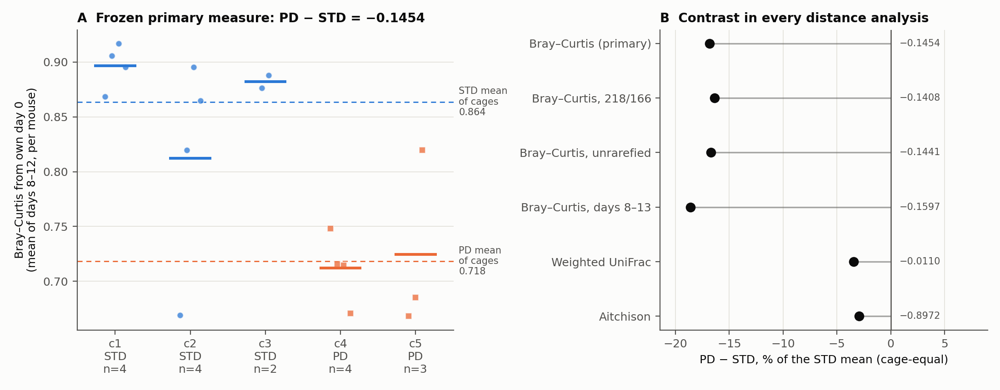

# Ng 16S Reanalysis

A prespecified reanalysis of the 16S rRNA V4 data from **Ng et al. 2019**, *Recovery of the gut microbiota after antibiotics depends on host diet, community context, and environmental reservoirs* (Cell Host & Microbe 26:650–665, [doi:10.1016/j.chom.2019.10.011](https://doi.org/10.1016/j.chom.2019.10.011)). This repository covers the **humanised-mouse experiment**: mice colonised with one human donor's microbiota, on a standard (STD) or a MAC-deficient (PD) diet, treated with ciprofloxacin.

| Stage | What | Tools |
|---|---|---|
| 1 | Reprocessing from raw reads, frozen analysis plan, primary and sensitivity analyses | QIIME 2 2026.10, DADA2, SILVA 144, q2-boots |
| 2 | Reproducibility check: the same reads through a matched second workflow | nf-core/ampliseq 3.1.0 (Nextflow, Docker) |
| 3 | Interpretation and report | [Project report](docs/Ng_16S_Reanalysis_Project_Report.md) |

**Status:** humanised experiment complete. The conventional-mouse experiment is on hold (see [decisions](docs/DECISIONS.md), D4 and D15).

## Main findings

The full results, figures and limits are in the [project report](docs/Ng_16S_Reanalysis_Project_Report.md).

- **Frozen primary result.** During days 8–12 after ciprofloxacin began, the two PD cages were closer to their own day-0 community composition than all three STD cages (Bray–Curtis, cage-equal; PD − STD = −0.145). Individual mice overlap between diets.
- **Sensitivity.** The cage pattern was stable across the tested Bray–Curtis versions and sensitive to the distance metric: weighted UniFrac and Aitchison distance gave overlapping cage values.
- **Communities.** PD mice had lower richness in the same-run window, and the PD-associated Muribaculaceae ASV fell to near the detection limit.
- **Reproducibility.** nf-core/ampliseq with DADA2 settings matched to Stage 1 reproduced the result (−0.1453 against −0.1454).
- **Limit.** Baseline sequencing run differed by diet, and concurrent treatment of the diet groups could not be verified, so the reanalysis cannot establish a diet effect on recovery.



## How the analysis was protected from its own results

- **Analysis plan frozen before any diet result.** [`docs/ANALYSIS_SPEC_FROZEN_v1.md`](docs/ANALYSIS_SPEC_FROZEN_v1.md) was committed and tagged as `analysis-frozen-v1` before any diversity value was compared by diet or time. The exact input artifacts were recorded by checksum in [`docs/frozen_artifacts.tsv`](docs/frozen_artifacts.tsv), and the analysis scripts stop if an input has changed.
- **Stage 2 rules fixed before the ampliseq run.** [`docs/STAGE2_COMPARISON_SPEC_v1.md`](docs/STAGE2_COMPARISON_SPEC_v1.md) was tagged as `stage2-spec-v1`, including a numeric decision rule. [`docs/STAGE2_PARAMETER_MATCH.md`](docs/STAGE2_PARAMETER_MATCH.md) maps every DADA2 setting between the two workflows, checked against both source codes.
- **Analyses added later are labelled exploratory.** Every choice and amendment is in the [decision table](docs/DECISIONS.md).

## Repository layout

```
scripts/    numbered scripts, run in order from the repository root (usage in each header)
config/     QIIME 2 environment file, nf-core/ampliseq parameters and module config, SILVA public key
metadata/   sample metadata, barcode files, exclusions, checksums, frozen sample list
docs/       report, figures, frozen specifications, decision table and reference documents
```

Not tracked: `data/` (raw reads, QIIME 2 artifacts), `results/` and `work/`. All of these are rebuilt by the scripts.

## Reproducing the analysis

**Requirements:**

- Linux or WSL2; about 25 GB free disk for the humanised experiment.
- conda, for QIIME 2; Docker and Nextflow 26.10.5, for Stage 2.

See [`docs/ENVIRONMENT.md`](docs/ENVIRONMENT.md) for exact versions and build commands, and [`docs/DATA_AND_SAMPLES.md`](docs/DATA_AND_SAMPLES.md) for the data source and sample sets.

**Inputs:**

- Raw reads come from the Stanford Digital Repository object [`rm696bw4911`](https://purl.stanford.edu/rm696bw4911) (CC BY-NC 3.0). Script 04 downloads them and verifies them against `metadata/raw_sha256_humanised.txt`.
- Scripts 01–03 and 05 also read the depositors' `mapping_files.xlsx` from the same object. It is not redistributed here; its derived sample metadata is committed in `metadata/`.

**Steps** (run from the repository root; each script's header gives its exact usage):

| Scripts | Step | Environment |
|---|---|---|
| 00–03 | Read and barcode checks on small read samples; sample-sheet coverage | Python 3 |
| 04 | Download and verify raw reads | bash |
| 05–07 | Sample metadata, demultiplexing (EMP paired-end, Golay), demultiplexing check | QIIME 2 |
| 08–10 | DADA2 (200/150 primary, 218/166 sensitivity), technical checks, setting comparison | QIIME 2 |
| 11–13 | Download and verify the SILVA 144 classifier (MD5, GPG signature); taxonomy; checks | QIIME 2 |
| 14–16 | Tree; rarefaction-depth check; q2-boots core metrics (6,400 reads, n = 100, seed 20261113) | QIIME 2 |
| 17 | Freeze check: sample list and artifact checksums | Python 3 |
| 18–19 | Frozen primary, sensitivity and secondary analyses | QIIME 2 (numpy, matplotlib) |
| 20, 26 | Exploratory analyses | QIIME 2 (numpy, matplotlib) |
| 21–25 | Stage 2: per-sample FASTQ export, ampliseq run and checks, Stage 1 downstream on ampliseq output, comparison | QIIME 2, Docker, Nextflow |
| 27 | Report figures | QIIME 2 (matplotlib) |

`bash scripts/status.sh` reports whether a long-running step is still active.

**Rough run times** (6 CPUs):

- DADA2 and q2-boots: about 0.5 h and 2 h per truncation setting, respectively.
- nf-core/ampliseq: about 1 h.

## Data licence and citation

The sequencing data and sample sheet are by Ng et al. and licensed CC BY-NC 3.0 by the depositors. If you use this reanalysis, please cite the original study, and the tools listed in the [report's references](docs/Ng_16S_Reanalysis_Project_Report.md#references).
