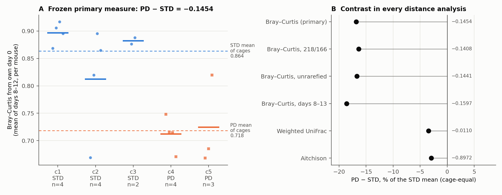
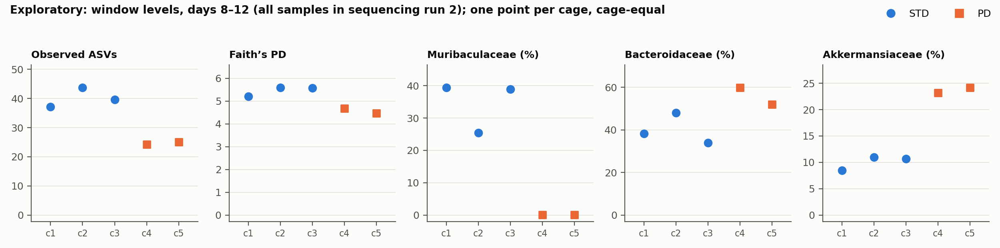
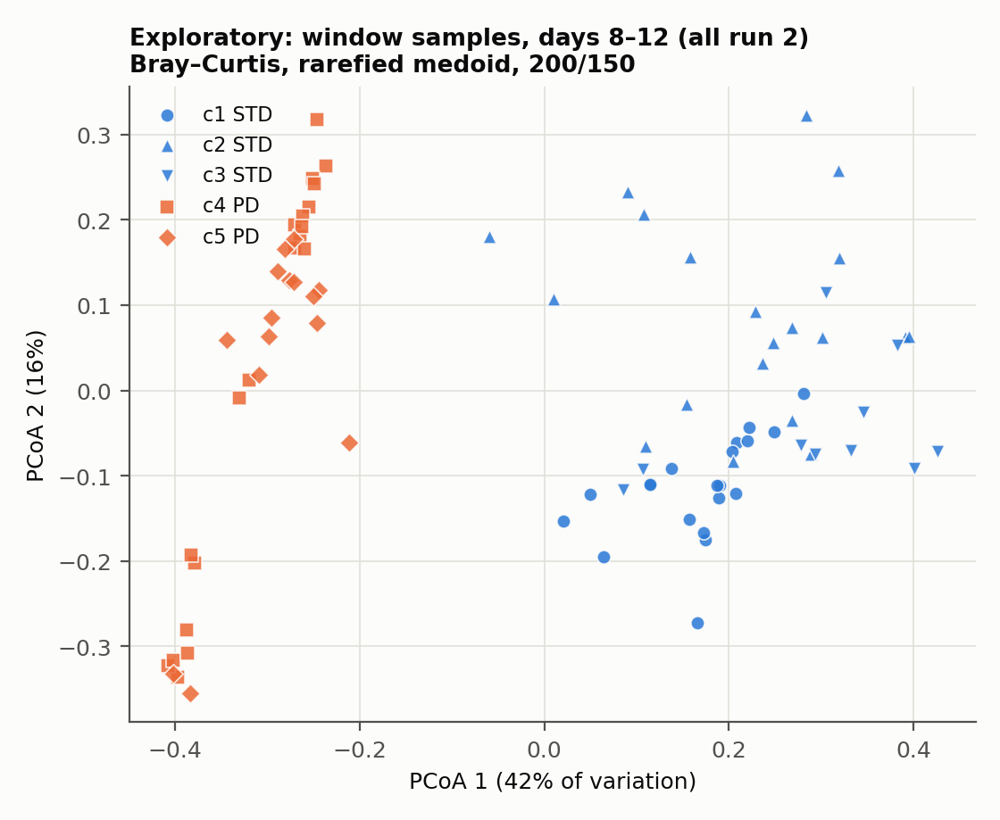
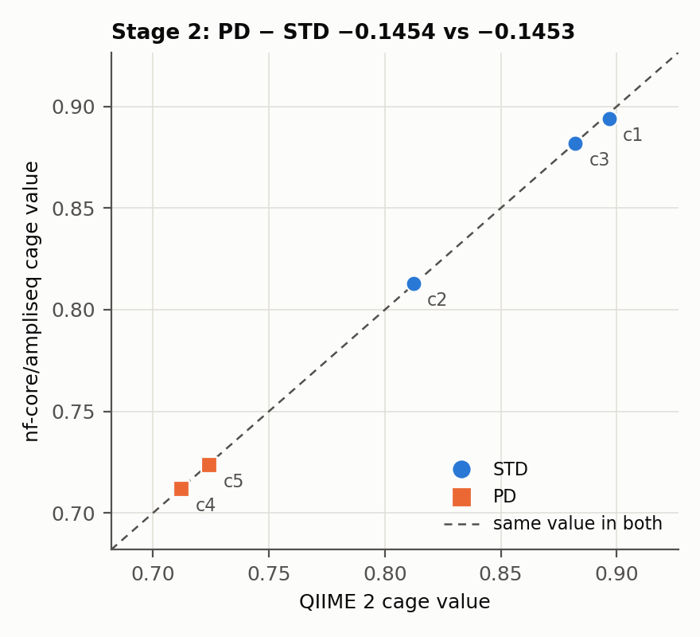

# Ng et al. 2019 16S rRNA reanalysis: recovery after ciprofloxacin on two diets

**Humanised-mouse experiment. Stage 3 report.**

16 November 2026 (revised after independent review). Analysis tags: `analysis-frozen-v1` (frozen analysis) and `stage2-spec-v1` (Stage 2 comparison rules). Repository state: commit `6f3f6ae` plus this report.

## Summary

- **Data.** The public 16S rRNA V4 data of Ng et al. (2019; Stanford Digital Repository `rm696bw4911`) were reprocessed from raw reads: humanised mice (single human donor) on a standard (STD) or a MAC-deficient, fibre-poor (PD) diet, treated with ciprofloxacin. The processing used QIIME 2 2026.10, DADA2 and SILVA 144.
- **Frozen primary result.** During days 8–12, PD cages were closer to their own day-0 composition than STD cages. The mean Bray–Curtis distance from day 0 over days 8–12 was 0.718 against 0.864, a PD − STD difference of **−0.145**. Both PD cages fell below all three STD cages, although individual mice overlap between diets. The result was stable across the tested Bray–Curtis versions and sensitive to the distance metric: weighted UniFrac and Aitchison showed little difference.
- **What changed in the communities.** PD mice were less diverse after the antibiotic, and the PD-associated Muribaculaceae ASV fell to near the detection limit. In STD mice, Muribaculaceae rose above its day-0 level. In the unrarefied Bray–Curtis analysis, Muribaculaceae ASVs contribute −0.177 to the −0.144 contrast, partly offset by other families.
- **Different questions.** Closeness to the starting composition, and diversity or the taxa present, measure different things. A community can sit closer to its start while being less diverse and missing a family it carried before.
- **Reproducibility.** The same reads processed by nf-core/ampliseq 3.1.0, with DADA2 settings matched to Stage 1, gave −0.1453 against −0.1454, and the same cage pattern.
- **Main limit.** All STD baselines were sequenced in a different run from every other sample used, and concurrent treatment of the diet groups could not be verified. The reanalysis therefore cannot establish a diet effect on recovery.

## 1. Question and design

Ng et al. (2019) studied how the gut microbiota recovers after antibiotics. In the experiment reanalysed here:

- Swiss-Webster mice were colonised with one healthy human donor's faecal microbiota.
- One group stayed on standard chow (STD). The other was moved to a defined diet low in microbiota-accessible carbohydrates (MAC-deficient) for two weeks before ciprofloxacin. The deposited mapping sheet labels this group PD; it is interpreted here as the paper's MD (MAC-deficient) arm.
- Ciprofloxacin was given by oral gavage for five days, starting on day 0. Faecal samples were collected over time.

The paper reports delayed recovery and the elimination of S24-7 (now Muribaculaceae) on the MAC-deficient diet. The paper compares its MD mice with the STD mice of its Figure 1; whether the two groups were treated concurrently could not be verified.

**Data source:** Stanford Digital Repository object `rm696bw4911` (purl.stanford.edu/rm696bw4911; CC BY-NC 3.0), as cited in the paper's data availability statement.

**Question:** how far is each diet group from its own pre-antibiotic (day 0) community during the late recovery window, days 8–12?

**Unit of replication: the cage.** Mice in a cage share microbes, so they are not independent.

| Diet | Cages (mice per cage) | Eligible mice | Samples |
|---|---|---|---|
| STD | H_c1 (4), H_c2 (4), H_c3 (2) | 10 | 60 |
| PD | H_c4 (4), H_c5 (3) | 7 | 42 |

Eligible mice are those with a day-0 faecal sample and a sample on each of days 8–12: **10 of 10 STD mice and 7 of 10 PD mice** (H_m14, H_m16 and H_m17 have no window samples). The 1-, 3- and 5-day eligibility rules gave the same 17 mice.

**Known design constraint.** STD day-0 samples were sequenced in run 1. PD day-0 samples and all days 8–12 samples of both diets were sequenced in run 2.

**Three stages:**

1. QIIME 2 reanalysis.
2. Reproducibility check with nf-core/ampliseq.
3. Interpretation (this report).

The conventional-mouse experiment is on hold (D4, D15).

## 2. Processing (Stage 1)

| Step | Method | Result |
|---|---|---|
| Raw data | 9 files from the Stanford Digital Repository (`rm696bw4911`); size, gzip integrity and read counts verified; project SHA-256 recorded | 29,972,853 read pairs, 3 runs |
| Demultiplexing | EMP paired-end with Golay error correction; barcodes used as reverse complements (established by simulation) | 8,021,623 read pairs to 453 samples; 2 failed libraries excluded (D19) |
| Primers | None in the reads; 253 bp V4 amplicon (515F/806R) | No trimming |
| DADA2 | Each run separately, then merged. Truncation 200/150 (chosen on technical evidence only, before any biological result); maxEE 2/2; truncQ 2; independent inference; consensus chimera removal | 794 ASVs; ≥ 6,527 reads per sample. 218/166 kept as a sensitivity setting (D20a) |
| Taxonomy | Official SILVA 144 V4 515F/806R classifier; size, MD5 and GPG signature verified (D24) | 99.2% of reads named to family; no mitochondria or chloroplast |
| Tree | MAFFT, FastTree, midpoint root | 794 of 794 ASVs on the tree |
| Depth | Rarefaction curves grouped by run only | All metrics at plateau at 6,400 reads |
| Diversity | q2-boots: 100 rarefactions to 6,400 reads, seed 20261113; alpha averaged by mean, distance matrices by medoid (D27) | All 451 samples retained |

## 3. Analysis plan, frozen before any diet result

The specification (`docs/ANALYSIS_SPEC_FROZEN_v1.md`) was committed and tagged before any diversity value was compared by diet or time (D28). A check script then confirmed all 102 samples in every output and recorded each artifact's checksum. Later analysis scripts refuse to run if an input has changed.

- **Primary measure.** For each mouse: the mean Bray–Curtis distance (rarefied medoid, 200/150) of its five window samples from its own day-0 sample. Mice are averaged within cage, and cages weighted equally within diet. **Δ = PD − STD.**
- **No p-value.** Five cages allow only 10 relabellings, and cages are not exchangeable, because baseline run differs by diet. All cage values are shown instead.
- **Sensitivity analyses:**
  - S1: 218/166 truncation;
  - S2: unrarefied Bray–Curtis on relative abundances;
  - S3: Aitchison distance (prevalence ≥ 10%, pseudocount 1, CLR);
  - S4: days 8–13.
- **Secondary measures:** observed ASVs, Faith's PD, weighted UniFrac, and three families (Muribaculaceae, Bacteroidaceae, Akkermansiaceae).

Analyses added after the freeze are labelled **exploratory**.

## 4. Results

### 4.1 Frozen primary measure

*Figure 1. A: Bray–Curtis distance from each mouse's own day-0 sample, mean of days 8–12. Points are mice, bars are cage means, and dashed lines are the cage-equal diet means. B: the PD − STD contrast in every distance-from-baseline analysis, as % of the STD mean (the metrics have different scales); the contrast in the original metric's units is printed on the right.*

Δ = −0.1454: STD 0.8637, PD 0.7183.

| Diet | Cage | Mice | Cage mean |
|---|---|---|---|
| STD | H_c1 | 4 | 0.897 |
| STD | H_c2 | 4 | 0.812 |
| STD | H_c3 | 2 | 0.882 |
| PD | H_c4 | 4 | 0.712 |
| PD | H_c5 | 3 | 0.724 |

Both PD cages fall below all three STD cages. **Individual mice overlap between diets** (STD 0.669–0.917, PD 0.668–0.820). STD mouse H_m5 (cage H_c2, 0.669) lies below six of the seven PD mice, and PD mouse H_m20 (cage H_c5, 0.820) is level with STD mouse H_m6 (0.820). The separation is therefore a property of cage means. The cage is the unit of replication, but with five cages the separation describes consistency; it is not a test.

Among the 10 possible cage relabellings, the observed one is the most extreme. This is a description of position, not a test. Both diets remain far from their day-0 composition (0.71–0.90).

### 4.2 Sensitivity

| Analysis | Δ (PD − STD) | Pattern |
|---|---|---|
| Primary: Bray–Curtis, rarefied, 200/150 | −0.1454 | Both PD cages below all STD cages |
| S1: Bray–Curtis, 218/166 | −0.1408 | Same (shift +0.0046) |
| S2: Bray–Curtis, unrarefied | −0.1441 | Same |
| S4: Bray–Curtis, days 8–13 | −0.1597 | Same |
| Weighted UniFrac (secondary) | −0.0110 | STD cages (0.258–0.379) bracket PD (0.304–0.315) |
| S3: Aitchison | −0.897 on a scale of ~30 | STD H_c3 below both PD cages |

**Reading:** stable across the tested Bray–Curtis versions; sensitive to the choice of distance metric.

### 4.3 Secondary measures (frozen)

Changes are from day 0 to the days 8–12 mean, averaged with equal cage weight.

| Measure | STD | PD | Note |
|---|---|---|---|
| Observed ASVs | 71.0 → 40.2 | 65.7 → 24.7 | Δ change −10.1; cages overlap; size moderately sensitive to truncation (ratio 0.72) |
| Faith's PD | 8.01 → 5.45 | 7.69 → 4.57 | Δ change −0.56; all PD cages below all STD cages; size sensitive (ratio 1.38) |
| Muribaculaceae | 14.9% → 34.6% | 9.0% → trace | Δ change −0.286 |
| Bacteroidaceae | 39.8% → 40.1% | 27.5% → 55.9% | Δ change +0.282 |
| Akkermansiaceae | 2.8% → 10.0% | 25.2% → 23.7% | PD level already high at day 0 |

For observed ASVs and Faith's PD, only the direction of the change is treated as robust (D21).

### 4.4 Exploratory analyses

**Window levels.** All days 8–12 samples of both diets were sequenced in run 2. Comparing levels in that window removes the run difference between baselines. It does not remove possible cohort or preparation differences.

*Figure 2 (exploratory). Cage means of the days 8–12 window. Circles are STD, squares are PD.*

On every measure, both PD cages lie beyond all three STD cages:

| Measure | STD | PD |
|---|---|---|
| Observed ASVs | 40.2 | 24.7 |
| Faith's PD | 5.45 | 4.57 |
| Muribaculaceae | 34.6% | trace |
| Bacteroidaceae | 40.1% | 55.9% |
| Akkermansiaceae | 10.0% | 23.7% |

These contrasts barely change with truncation: richness −15.5 against −14.6, and Faith's PD −0.88 against −0.89.

**Between-cage distances.** Window samples, rarefied Bray–Curtis:

- Every cage pair across diets: 0.60–0.73.
- Every pair of different cages on the same diet: 0.34–0.45.

*Figure 3 (exploratory). PCoA of window samples (rarefied Bray–Curtis, 200/150), coloured by diet, marker by cage. Axis 1 (42% of variation) separates the diets. The PD samples also form two groups along axis 2, each containing both PD cages; this structure was not investigated (time within the window is one candidate).*

**Family contributions to the unrarefied Bray–Curtis contrast.** For a pair of samples, the unrarefied Bray–Curtis distance is half the sum of absolute changes in relative abundance, so it splits exactly into one part per family. Averaged like S2:

| Family | Part of the PD − STD contrast |
|---|---|
| Muribaculaceae | −0.177 |
| Bacteroidaceae | −0.044 |
| Akkermansiaceae | +0.061 |
| Desulfovibrionaceae | +0.023 |
| **Total (S2)** | **−0.144** |

This is an accounting of the S2 contrast, not a causal attribution. A single family's part can exceed the total (−0.177 against −0.144) because other families' parts have the opposite sign. Muribaculaceae makes up 25.8% of the STD distance. In STD mice, its part exceeds what its net rise alone would produce, so turnover between Muribaculaceae ASVs also contributes.

**Muribaculaceae at sequence-variant level.** Reads were checked per sample and per ASV. In the 35 PD window samples there are 142 reads, from two ASVs, spread over 17 samples and at most 15 reads in any one sample.

- **The PD-associated Muribaculaceae ASV.** Before the antibiotic it was in 44 of 49 PD samples, from 9 mice and including day −14 in run 1, at about 1.7% of reads. It was never seen in STD run-2 samples. After the antibiotic it left 3 reads in 1 of 35 window samples.
- **The trace ASV (139 reads).** This is the dominant Muribaculaceae ASV of STD run-2 samples, at a mean 30% of reads. In PD mice it appears only in run-2 samples, at trace level (0.08%) already before the antibiotic, and never in the run-1 day −14 samples.

Of the 142 reads, 3 come from the PD-associated ASV and 139 from the ASV dominant in co-sequenced STD samples. That pattern is consistent with cross-talk between samples of the same run; its source remains unresolved, because no extraction blanks or mock communities were documented in the materials reviewed.

**Wording used:** *the PD-associated ASV fell to near the detection limit; trace reads of the STD-dominant ASV remained.*

### 4.5 Stage 2: reproducibility with nf-core/ampliseq

**Design (D30).**

- The Stage 1 demultiplexed reads were exported as per-sample FASTQ files with checksums. Each sample's read count was checked against the Stage 1 DADA2 input.
- nf-core/ampliseq 3.1.0 (Nextflow 26.10.5, Docker) was run on all 451 samples. Before the run, the ampliseq and q2-dada2 source code were compared and three defaults set to match Stage 1:
  - independent sample inference (3.x pools by default);
  - error learning with `nreads = 1e6, randomize = FALSE`;
  - chimera `minFoldParentOverAbundance = 1`.
- Both workflows used DADA2 1.38.0 and R 4.5.2.
- The ampliseq ASVs were then classified, built into a tree and rarefied exactly as in Stage 1.
- The comparison rules, including the decision rule, were tagged before any ampliseq output existed.

*Figure 4. Cage values of the frozen primary measure, QIIME 2 against nf-core/ampliseq.*

| Comparison | Result |
|---|---|
| Read retention | Nearly identical across stages and runs; median final read-count ratio 1.000, range 0.983–1.001 across samples |
| ASVs | 788 shared, carrying 99.99% of QIIME 2 reads and 100.00% of ampliseq reads (to two decimals). 6 QIIME 2-only ASVs (largest 0.006% of reads) and 47 ampliseq-only ASVs (each < 0.001%) |
| Same sample, two workflows | Bray–Curtis median 0.0000, maximum 0.017. For comparison, the two truncation settings within Stage 1 differ by median 0.024, maximum 0.044 |
| Taxonomy | All shared ASVs classified identically; Muribaculaceae traces identical |
| **Frozen primary measure** | **Δ −0.1453 against −0.1454**: a difference of 0.0001, well within the prespecified 0.02 tolerance; same direction; cage pattern unchanged |

The four samples where the workflows differ by more than 0.01 each contain one rare QIIME 2-only variant, 1–2 bases from an abundant shared ASV. Only one of the four is in the frozen set.

**What Stage 2 shows.** Both workflows used the same demultiplexed reads, matched DADA2 settings and a common downstream analysis, so their agreement supports **reproducibility under those conditions**. Robustness to analysis choices is what the sensitivity analyses address.

Faith's PD was the measure most affected by the workflow change: window contrast −0.88 against −0.77. Its tree is rebuilt from every ASV, so rare ASVs carrying almost no reads still change branch lengths.

## 5. Discussion

**The measures answer different questions.**

- **Distance from the own day-0 sample.** PD cages were closer to their own day-0 composition during days 8–12. The endpoint measures distance from day 0 in a defined window: it cannot distinguish a smaller initial disruption, a faster return, or an overshoot in the other group. Two features of the design bear on it. For the PD arm, day 0 followed two weeks on the assigned diet, and the day-0 communities already differed (Akkermansiaceae 25% against 3% in STD; the cause of that difference is left open). And every STD baseline comparison crosses sequencing runs.
- **Diversity and taxa present.** PD mice were less diverse after the antibiotic, and the PD-associated Muribaculaceae ASV fell to near the detection limit. In STD mice, Muribaculaceae rose above its day-0 level.

The distance endpoint therefore neither supports nor contradicts the paper's conclusion that the MAC-deficient diet delays recovery.

**Observations alongside the original study:**

- Muribaculaceae (the paper's S24-7): the PD-associated ASV fell to near the detection limit.
- Alpha diversity was somewhat lower in PD mice before treatment (here 65.7 against 71.0 ASVs) and fell further after it, in the direction the paper reports.
- Akkermansiaceae (Akkermansia, a mucin user) was high in PD mice already at day 0.

**Limits:**

1. **Sequencing run.** Every STD baseline-to-window distance crosses from run 1 to run 2, while every PD distance stays within run 2. A run effect has a route into the primary contrast, but its direction and size cannot be estimated from these data.
2. **Cohort comparability.** The paper compares the MD mice with the STD mice of its Figure 1, and concurrent treatment could not be verified. Here, STD and PD mice carry different dominant Muribaculaceae ASVs, consistent with different colonisation histories. Whether the PD day −14 sample precedes the diet switch is unconfirmed.
3. **Replication.** There are five cages (three STD, two PD), mouse values overlap between diets, and no p-values are reported. Consistency across cages, measures and processing choices is the evidence offered.
4. **Controls.** No extraction blanks or mock communities were documented in the materials reviewed, so contamination and cross-talk cannot be measured directly.
5. **Scope.** One human donor, humanised mice only, one antibiotic; the conventional-mouse experiment is not analysed.

**Conclusion.** During days 8–12 after ciprofloxacin began, the two low-MAC cages were closer to their own day-0 faecal community composition by Bray–Curtis than all three standard-diet cages. They also had lower observed ASV richness in that same-run window. The cage pattern held across the tested Bray–Curtis specifications and in the matched nf-core/ampliseq workflow. Weighted UniFrac and Aitchison distance gave overlapping cage values. Baseline sequencing run differed by diet, and concurrent treatment could not be verified, so the reanalysis cannot establish a diet effect on recovery.

## 6. Reproducibility record

**Versions:**

- QIIME 2 2026.10 (conda environment file in `config/`), DADA2 1.38.0, R 4.5.2.
- nf-core/ampliseq 3.1.0, commit `b9bd579c04`; Nextflow 26.10.5; container digests recorded in the project record.

**Frozen rules:**

- `docs/ANALYSIS_SPEC_FROZEN_v1.md` (tag `analysis-frozen-v1`), with `docs/frozen_artifacts.tsv` (artifact UUIDs and MD5s) and `metadata/primary_analysis_samples.tsv`.
- `docs/STAGE2_COMPARISON_SPEC_v1.md` and `docs/STAGE2_PARAMETER_MATCH.md` (tag `stage2-spec-v1`).

**Scripts** (`scripts/`, numbered in run order):

| Scripts | Purpose |
|---|---|
| 00–04 | Read check, barcode census, sample-sheet coverage, raw download with checksums |
| 05–07 | Sample metadata; demultiplexing; demultiplexing check |
| 08–10 | DADA2 (two truncation settings); technical checks; arm comparison |
| 11–13 | SILVA classifier (verified); taxonomy; taxonomy check |
| 14–16 | Tree; rarefaction curves and check; q2-boots core metrics |
| 17–19 | Freeze check; primary and sensitivity analyses; secondary measures |
| 20 | Exploratory window analysis and family decomposition |
| 21–25 | Stage 2: FASTQ export; ampliseq run and checks; downstream; comparison |
| 26–27 | Exploratory checks (trace origin, workflow differences); report figures |

The decision table (D1–D32) is kept with the project working documents and is published with the end-of-project documentation (D11).

## References

- Ng KM, Aranda-Díaz A, Tropini C, et al. Recovery of the gut microbiota after antibiotics depends on host diet, community context, and environmental reservoirs. *Cell Host & Microbe* 2019; 26: 650–665. doi:10.1016/j.chom.2019.10.011
- Bolyen E, et al. Reproducible, interactive, scalable and extensible microbiome data science using QIIME 2. *Nature Biotechnology* 2019; 37: 852–857.
- Callahan BJ, et al. DADA2: high-resolution sample inference from Illumina amplicon data. *Nature Methods* 2016; 13: 581–583.
- Quast C, et al. The SILVA ribosomal RNA gene database project. *Nucleic Acids Research* 2013; 41: D590–D596.
- Straub D, et al. Interpretations of environmental microbial community studies are biased by the selected 16S rRNA (gene) amplicon sequencing pipeline. *Frontiers in Microbiology* 2020; 11: 550420 (nf-core/ampliseq).
- Ewels PA, et al. The nf-core framework for community-curated bioinformatics pipelines. *Nature Biotechnology* 2020; 38: 276–278.
- Di Tommaso P, et al. Nextflow enables reproducible computational workflows. *Nature Biotechnology* 2017; 35: 316–319.
